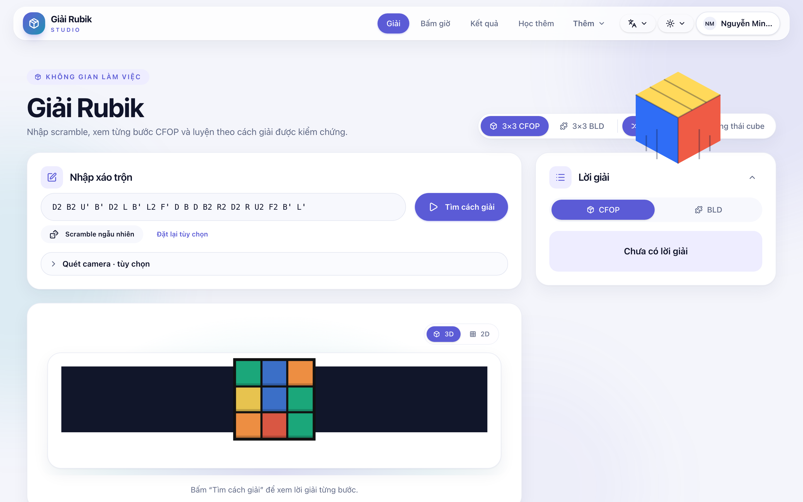
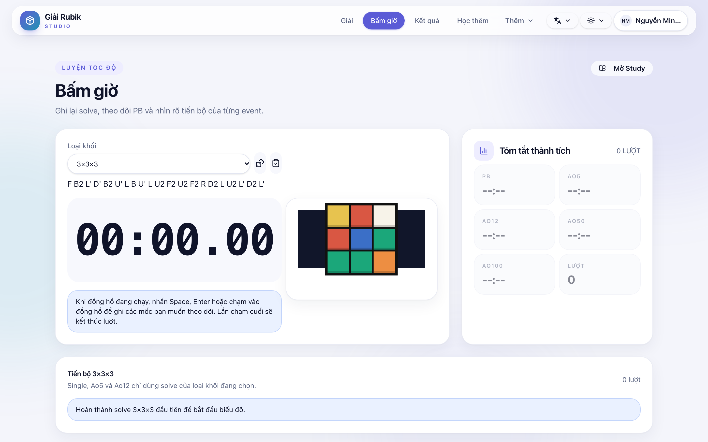
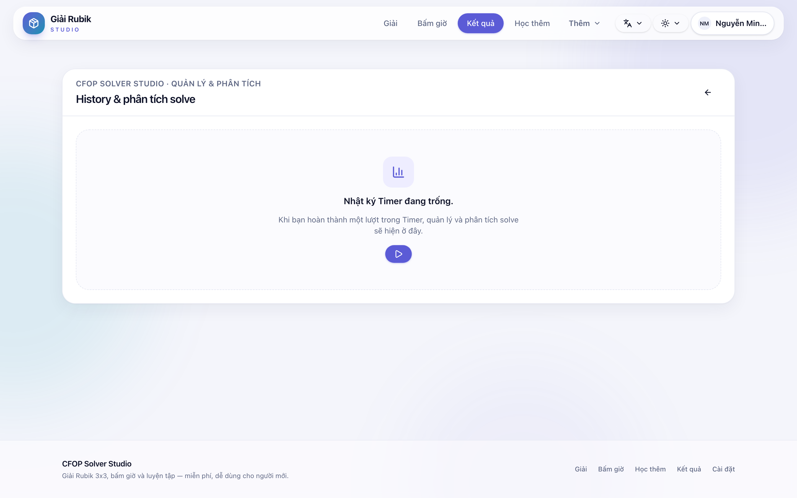
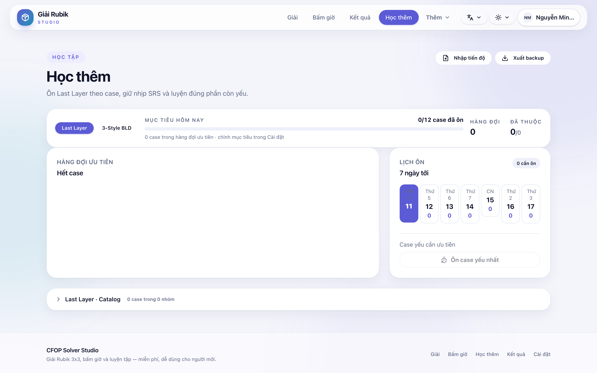
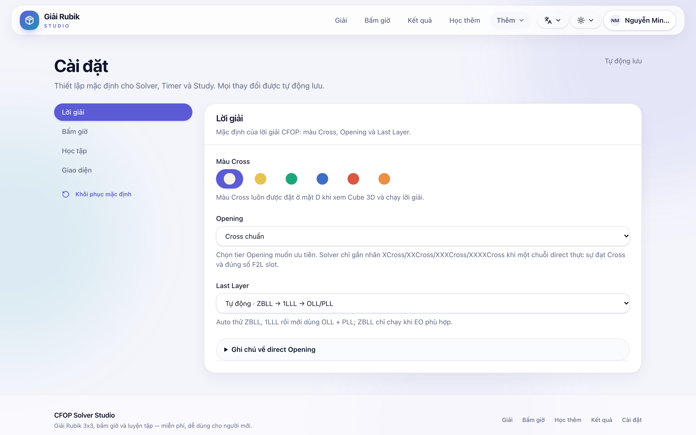

# CFOP Solver Studio

Open-source web app to solve, practise, time and compete at CFOP (3×3 Rubik's Cube) online.

[](https://github.com/Minhtuan622/cfop_solver_web/actions/workflows/ci.yml)
[](LICENSE)

## Demo

Try the live app: [cfop-solver.studio](https://cfop-solver.studio) (if available).

## Screenshots

| Solver | Timer | Results |
|--------|-------|---------|
|  |  |  |

| Study | Settings |
|-------|----------|
|  |  |

Regenerate them with `node scripts/capture-screenshots.mjs` while the dev server is running.

## Features

- CFOP/BLD solver: enter scramble or cube state, per-phase report, CubeNet/3D view.
- Multi-event timer with inspection, +2/DNF, splits, replay, history and statistics.
- Study: Last Layer and 3-Style BLD.
- Account, cloud sync, WCA, competition rooms and leaderboard.

## Run without a Database

The app can run most client-side features without a Database:

- Solve cube (solver), timer (Timer), study (Study), view local solve history.
- Theme, language and settings customization.

Features that **require** DATABASE_URL:
- CFOP account (sign up/sign in, change password).
- Cloud sync between devices.
- Competition rooms and leaderboard.
- WCA OAuth linking.

## Quick start locally

Requires Node.js 22+, pnpm **10.34.5**, Docker Desktop and Git. Local database uses MariaDB via Docker Compose — no need to install MySQL/MariaDB directly on macOS or Windows.

```bash
git clone https://github.com/Minhtuan622/cfop_solver_web.git
cd cfop_solver_web
corepack enable
pnpm install --frozen-lockfile
pnpm db:setup
pnpm dev
```

`pnpm db:setup` starts MariaDB at `127.0.0.1:3307`, creates/updates `.env.local` and applies Drizzle migrations. Start Docker Desktop first. Then open `http://localhost:3000`.

Common local database commands:

```bash
pnpm db:stop   # stop container, keep data
pnpm db:logs   # view MariaDB logs
pnpm db:reset  # delete volume and recreate database
```

Account, cloud sync, Rooms and WCA flows require `DATABASE_URL`. WCA OAuth and password-reset email are optional; see [.env.example](.env.example) and [development guide](docs/development/project-guide.md).

## Pre-Pull-Request checklist

```bash
pnpm check
pnpm test --run
pnpm exec playwright install  # first time, if Chromium is not installed
pnpm test:e2e
pnpm build
pnpm audit --prod --audit-level=high
```

`pnpm test:e2e` uses Playwright-managed Chromium (downloaded automatically). No system Chromium path required.

## Documentation

- [Documentation index](docs/README.md)
- [Detailed development guide](docs/development/project-guide.md)
- [Contributing](CONTRIBUTING.md)
- [Code of Conduct](CODE_OF_CONDUCT.md)
- [Security vulnerability reporting](SECURITY.md)

## Tech stack

- Frontend: React 19 + TypeScript 7 + Vite 8, Tailwind CSS/Studio UI.
- Backend: Express 5 + tRPC 11, Drizzle ORM, MySQL/MariaDB.
- Cubing.js, Three.js and Pyodide Web Worker for scramble, 3D cube and browser solver.
- Vitest/Testing Library for unit tests; Playwright for browser E2E.

Python solver source lives in [`solver-python/cfop_solver`](solver-python/cfop_solver). After editing the Python source, run `pnpm run embed-solver` to regenerate the Pyodide bundle used in the browser; do not edit `client/src/lib/embeddedSolver.ts` by hand.

## Contributing

Issues, documentation, testing and Pull Requests are welcome. Please read [CONTRIBUTING.md](CONTRIBUTING.md) before getting started.

## License

[MIT](LICENSE)
