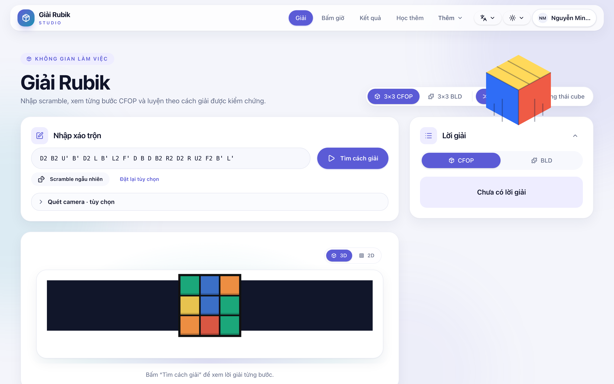
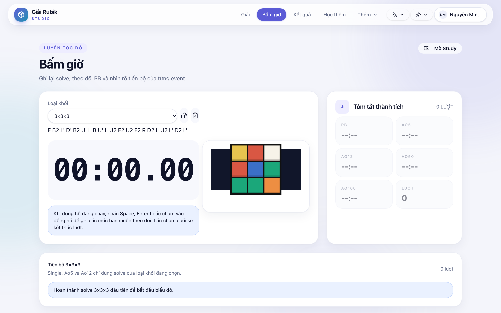
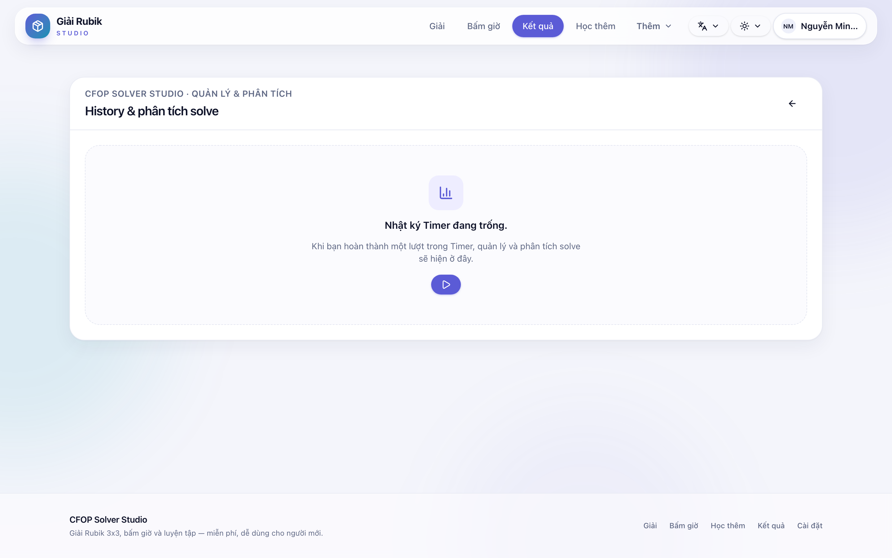
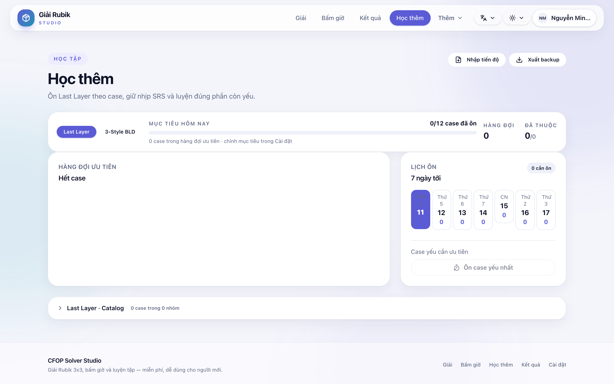
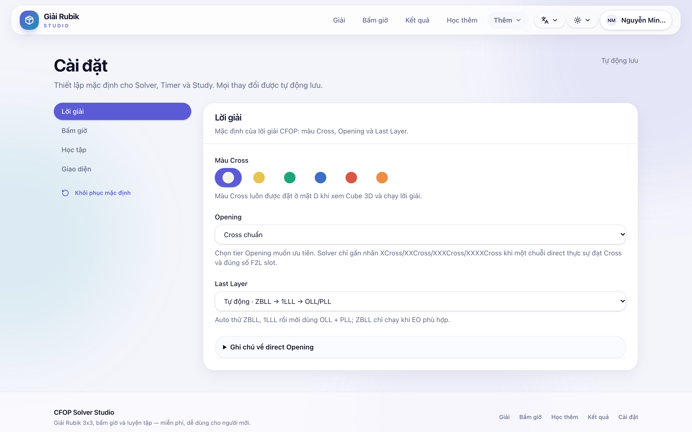

# CFOP Solver Studio

Ứng dụng web mã nguồn mở cho giải, luyện tập, bấm giờ và thi đấu Rubik trực tuyến.

[](https://github.com/Minhtuan622/cfop_solver_web/actions/workflows/ci.yml)
[](LICENSE)

## Demo

Thử ứng dụng trực tiếp: [cfop-solver.studio](https://cfop-solver.studio) (nếu có sẵn).

## Ảnh chụp màn hình

| Bộ giải | Bấm giờ | Kết quả |
|---------|---------|---------|
|  |  |  |

| Học thêm | Cài đặt |
|---------|---------|
|  |  |

Ảnh được sinh lại bằng `node scripts/capture-screenshots.mjs` khi dev server đang chạy.

## Tính năng chính

- Solver CFOP/BLD với nhập scramble, trạng thái sáu mặt, báo cáo theo phase và CubeNet/3D.
- Timer đa event với inspection, +2/DNF, split, replay, history và thống kê.
- Study cho Last Layer và 3-Style BLD.
- Tài khoản, đồng bộ dữ liệu, WCA, phòng thi đấu và bảng xếp hạng.

## Phần chạy được khi không có Database

Ứng dụng có thể chạy phần lớn tính năng phía **client** mà không cần Database:

- Giải Rubik (solver), bấm giờ (Timer), học tập (Study), xem lịch sử solve cục bộ.
- Tùy chỉnh chủ đề, ngôn ngữ, cài đặt cá nhân.

Phần **yêu cầu Database** (DATABASE_URL):
- Tài khoản CFOP (đăng ký/đăng nhập, đổi mật khẩu).
- Đồng bộ dữ liệu giữa các thiết bị (cloud sync).
- Phòng thi đấu (Rooms) và bảng xếp hạng.
- Liên kết WCA qua OAuth.

## Chạy local nhanh

Yêu cầu Node.js 22+, pnpm **10.34.5**, Docker Desktop và Git. Database local dùng MariaDB trong Docker Compose nên không cần cài MySQL/MariaDB trực tiếp trên macOS hoặc Windows.

```bash
git clone https://github.com/Minhtuan622/cfop_solver_web.git
cd cfop_solver_web
corepack enable
pnpm install --frozen-lockfile
pnpm db:setup
pnpm dev
```

`pnpm db:setup` sẽ khởi động MariaDB tại `127.0.0.1:3307`, tạo/cập nhật `.env.local` và áp dụng Drizzle migration. Hãy bật Docker Desktop trước khi chạy lệnh này. Sau đó mở `http://localhost:3000`.

Các lệnh database local thường dùng:

```bash
pnpm db:stop   # dừng container, giữ dữ liệu
pnpm db:logs   # xem log MariaDB
pnpm db:reset  # xóa volume và tạo lại database local
```

Các luồng account, cloud sync, Rooms và WCA cần `DATABASE_URL`. WCA OAuth và email đặt lại mật khẩu là tùy chọn; xem [file biến môi trường mẫu](.env.example) và [hướng dẫn phát triển](docs/development/project-guide.md) để cấu hình.

## Kiểm tra trước khi mở Pull Request

```bash
pnpm check
pnpm test --run
pnpm exec playwright install  # lần đầu, nếu máy chưa có Chromium
pnpm test:e2e
pnpm build
pnpm audit --prod --audit-level=high
```

`pnpm test:e2e` dùng Chromium do Playwright quản lý (tự động tải về). Không cần cài Chromium hệ thống.

## Tài liệu

- [Mục lục tài liệu](docs/README.md)
- [Hướng dẫn phát triển chi tiết](docs/development/project-guide.md)
- [Đóng góp cho dự án](CONTRIBUTING.md)
- [Quy tắc cộng đồng](CODE_OF_CONDUCT.md)
- [Báo cáo lỗ hổng bảo mật](SECURITY.md)

## Công nghệ và cấu trúc chính

- Frontend React 19 + TypeScript 7 + Vite 8, giao diện Tailwind CSS/Studio UI.
- Backend Express 5 + tRPC 11, Drizzle ORM và MySQL/MariaDB.
- Cubing.js, Three.js và Pyodide Web Worker cho scramble, cube 3D và solver trong trình duyệt.
- Vitest/Testing Library cho unit tests và Playwright cho browser E2E.

Source Python của solver nằm tại [`solver-python/cfop_solver`](solver-python/cfop_solver). Sau khi chỉnh sửa source, chạy `pnpm run embed-solver` để tái tạo bundle Pyodide được dùng trong trình duyệt; không chỉnh sửa thủ công `client/src/lib/embeddedSolver.ts`.

## Đóng góp

Issue, tài liệu, kiểm thử và Pull Request đều được chào đón. Vui lòng đọc [CONTRIBUTING.md](CONTRIBUTING.md) trước khi bắt đầu.

## License

[MIT](LICENSE)
