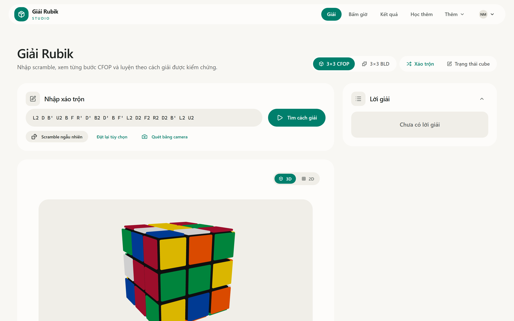
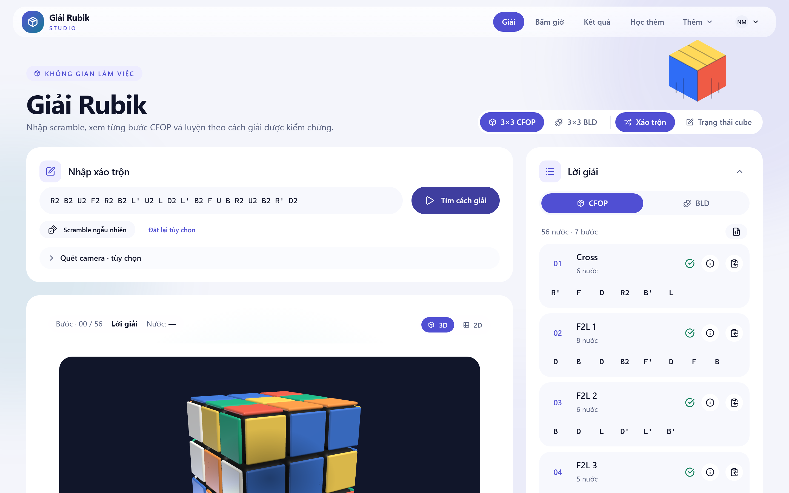
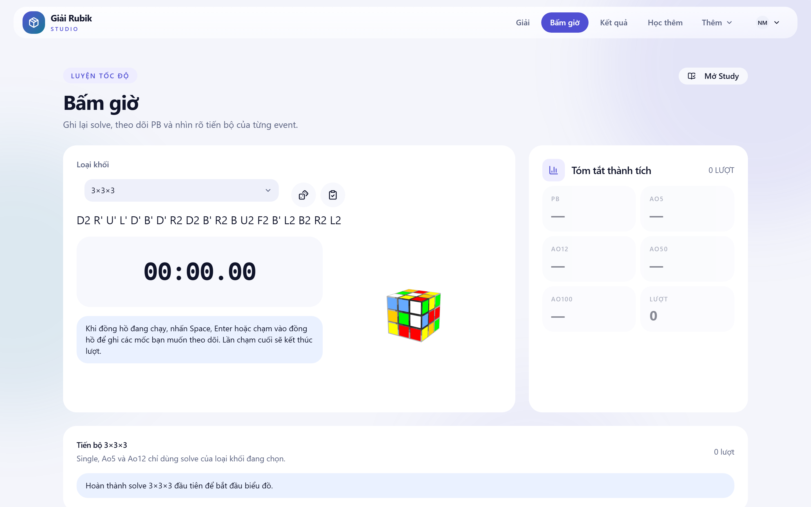
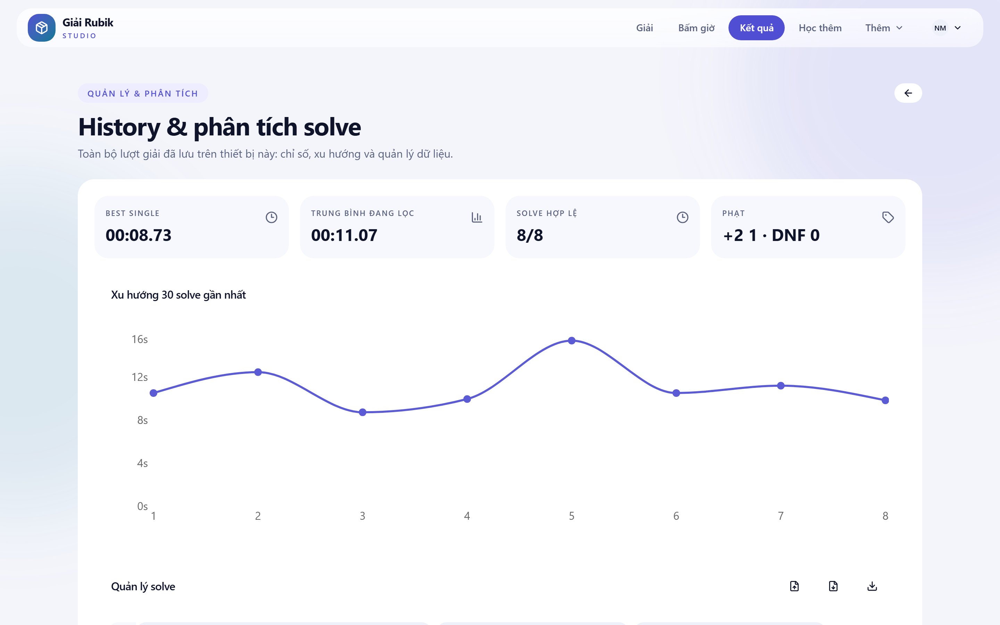
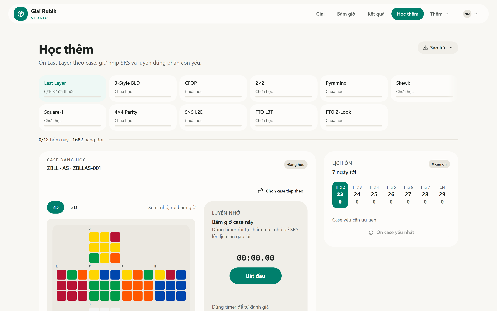
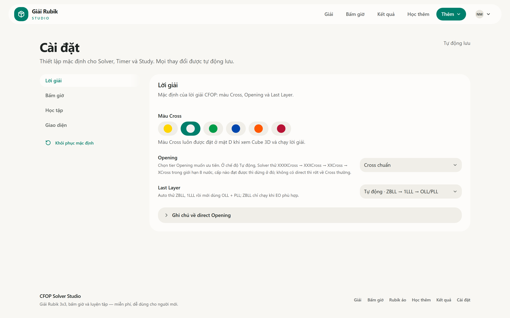
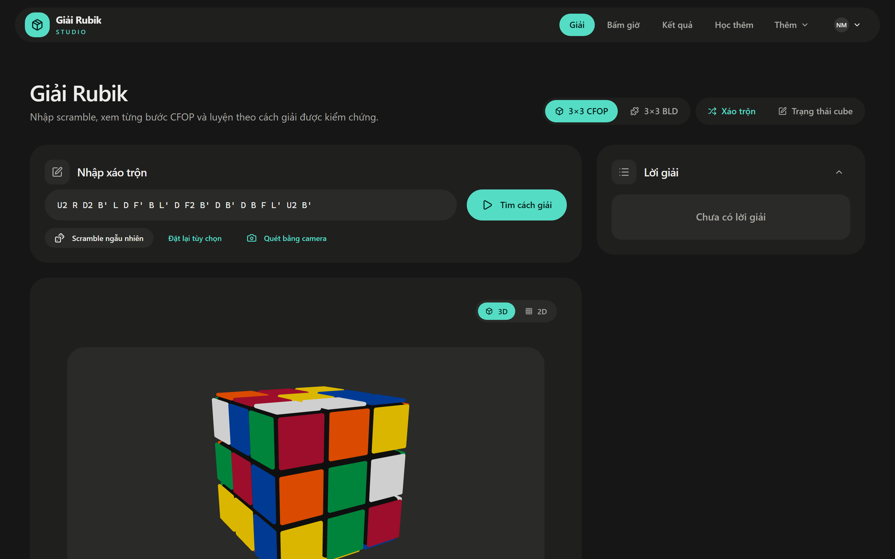
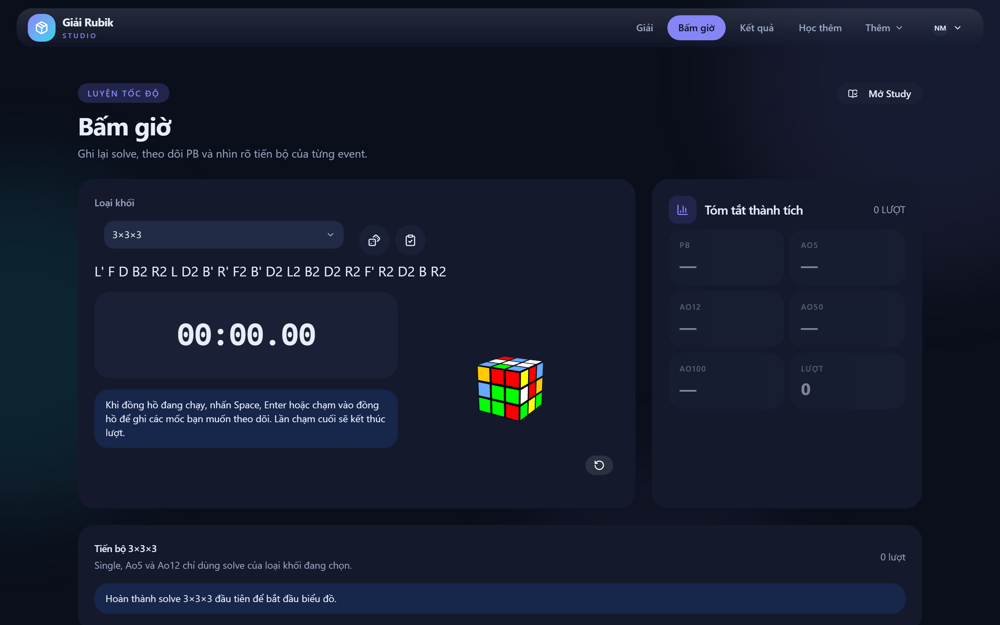
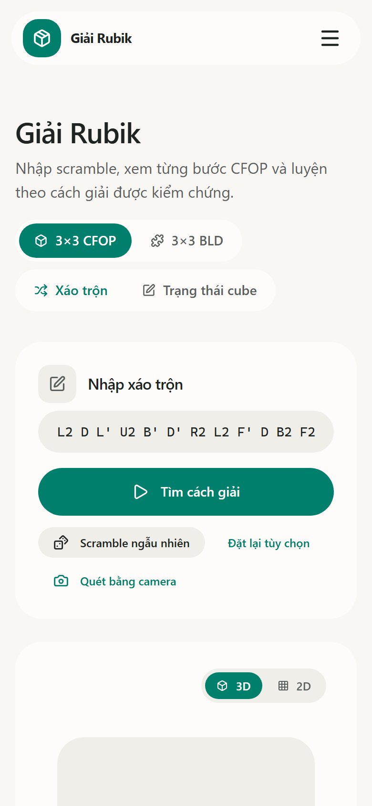
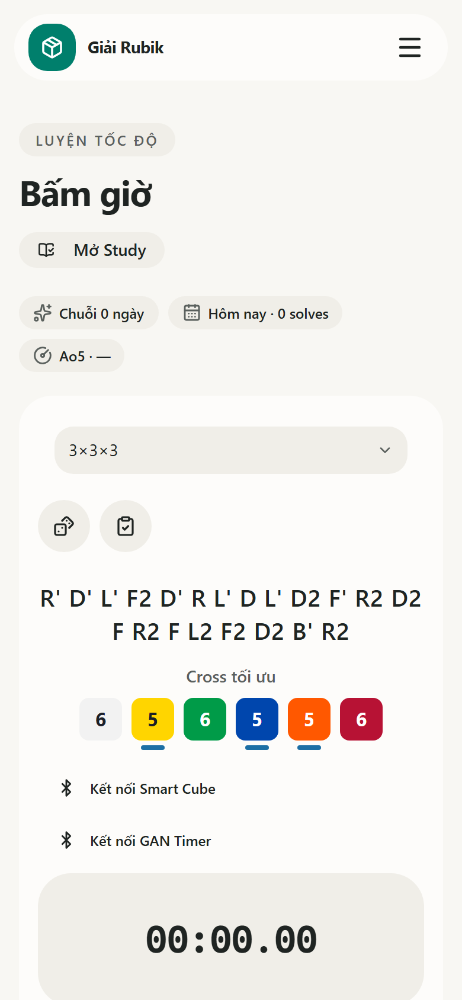

# CFOP Solver Studio

Ứng dụng web mã nguồn mở cho giải, luyện tập, bấm giờ và thi đấu Rubik trực tuyến.

[](https://github.com/Minhtuan622/cfop_solver_web/actions/workflows/ci.yml)
[](LICENSE)

## Demo

Thử ứng dụng trực tiếp: [cfop-solver.studio](https://cfop-solver.studio) (nếu có sẵn).

## Ảnh chụp màn hình

| Bộ giải | Lời giải CFOP | Bấm giờ |
|---------|----------------|---------|
|  |  |  |

| Kết quả | Học thêm | Cài đặt |
|---------|----------|---------|
|  |  |  |

Ảnh được sinh lại bằng `node scripts/capture-screenshots.mjs` khi dev server đang chạy. Trang Kết quả được chụp với dữ liệu demo (8 lượt giải 3×3 được nạp vào `localStorage`) để thể hiện chỉ số, biểu đồ xu hướng và danh sách lượt giải; các trang khác dùng trạng thái mặc định của ứng dụng.

### Chế độ tối (dark mode)

Ứng dụng có chế độ tối áp dụng cho mọi trang, kể cả bộ giải solver và khối 3D. Chuyển đổi **Sáng/Tối/Theo hệ thống** trong menu góc phải thanh điều hướng (nút chữ cái tên tài khoản → mục **Giao diện**) hoặc tại **Cài đặt → Giao diện**; lựa chọn được lưu trong `localStorage` và không nhấp nháy khi tải lại trang nhờ script pre-paint trong `index.html`.

| Trang chủ | Bấm giờ |
|-----------|---------|
|  |  |

### Giao diện mobile

Toàn bộ ứng dụng responsive trên màn hình nhỏ (ảnh dưới đây chụp ở khung 390×844px, tương đương iPhone): điều hướng chuyển sang menu hamburger, các lưới nội dung gom thành một cột, Timer và bộ giải vẫn dùng được đầy đủ trên điện thoại.

| Trang chủ | Bấm giờ |
|-----------|---------|
|  |  |

## Tính năng chính

- Solver CFOP/BLD: nhập scramble hoặc trạng thái sáu mặt, báo cáo theo phase, CubeNet/3D, opening "Tự động" (thử XXXXCross → XXXCross → XXCross → XCross; độ sâu tìm kiếm chỉnh được trong Cài đặt — mặc định 8 nước) và hiển thị case Last Layer (OLL/PLL, ZBLL, 1LLL) trên banner và trong danh sách phase.
- Timer đa event với inspection, +2/DNF, split, replay, history, thống kê và cỡ chữ scramble tuỳ chọn.
- Study cho Last Layer và 3-Style BLD.
- Tài khoản, đồng bộ dữ liệu, WCA, phòng thi đấu và bảng xếp hạng.
- Bộ giải chạy offline: Pyodide và catalog thuật toán BLD đều được tải về
  máy người dùng, không phụ thuộc CDN sau lần tải đầu.

## Phần chạy được khi không có Database

Ứng dụng có thể chạy phần lớn tính năng phía **client** mà không cần Database:

- Giải Rubik (solver), bấm giờ (Timer), học tập (Study), xem lịch sử solve cục bộ.
- Tùy chỉnh chủ đề, ngôn ngữ, cài đặt cá nhân.

Phần **yêu cầu Database** (DATABASE_URL):
- Tài khoản CFOP (đăng ký/đăng nhập, đổi mật khẩu).
- Đồng bộ dữ liệu giữa các thiết bị (cloud sync).
- Phòng thi đấu (Rooms) và bảng xếp hạng.
- Liên kết WCA qua OAuth.

## Chạy local nhanh

Yêu cầu Node.js 22+, pnpm **10.34.5**, Docker Desktop và Git. Database local dùng MariaDB trong Docker Compose nên không cần cài MySQL/MariaDB trực tiếp trên macOS hoặc Windows.

```bash
git clone https://github.com/Minhtuan622/cfop_solver_web.git
cd cfop_solver_web
corepack enable
pnpm install --frozen-lockfile
pnpm db:setup
pnpm dev
```

`pnpm db:setup` sẽ khởi động MariaDB tại `127.0.0.1:3307`, tạo/cập nhật `.env.local` và áp dụng Drizzle migration. Hãy bật Docker Desktop trước khi chạy lệnh này. Sau đó mở `http://localhost:3000`.

Các lệnh database local thường dùng:

```bash
pnpm db:stop   # dừng container, giữ dữ liệu
pnpm db:logs   # xem log MariaDB
pnpm db:reset  # xóa volume và tạo lại database local
```

Các luồng account, cloud sync, Rooms và WCA cần `DATABASE_URL`. WCA OAuth và email đặt lại mật khẩu là tùy chọn; xem [file biến môi trường mẫu](.env.example) và [hướng dẫn phát triển](docs/development/project-guide.md) để cấu hình.

## Kiểm tra trước khi mở Pull Request

```bash
pnpm check
pnpm test --run
pnpm exec playwright install  # lần đầu, nếu máy chưa có Chromium
pnpm test:e2e
pnpm build
pnpm audit --prod --audit-level=high
```

`pnpm test:e2e` dùng Chromium do Playwright quản lý (tự động tải về). Không cần cài Chromium hệ thống.

`pnpm build` **đã chạy `tsc --noEmit` ở đầu chuỗi**, nên build fail ở local cũng là lỗi type chứ không chỉ lỗi bundling. `pnpm check` vẫn đáng chạy riêng vì báo lỗi sớm hơn, trước bước tải Pyodide ~14 MB.

## Cổng chất lượng tự động

Ngoài unit test và e2e, repo còn có các cổng kiểm tra riêng — tất cả đều chạy trong CI và đều **đỏ** khi vi phạm:

| Cổng kiểm tra | Lệnh | Chặn cái gì |
|---|---|---|
| Tương phản token | `pnpm test --run server/contrast.test.ts` | Cặp màu chính rơi dưới WCAG AA (4.5:1 cho chữ, 3:1 cho vòng focus và biểu tượng trạng thái) ở **cả hai** chế độ sáng và tối. |
| Tương phản trên trang thật | `pnpm exec playwright test e2e/contrast-a11y.spec.ts` | Vi phạm axe mới trên 6 trang chính × 2 chế độ, và danh sách vi phạm đã biết (`e2e/contrast-a11y.baseline.json`) bị lỗi thời. |
| Hiệu năng bộ giải | `node scripts/bench-solver.mjs --check` | Bộ giải giải sai, hoặc một kịch bản vượt ngân sách: `cross` (mặc định 20s/đề, 80s tổng) hoặc `auto` (60s/đề, 200s tổng). |
| Ghim phiên bản Pyodide | `pnpm test --run server/pyodideAssets.test.ts` | Lệch phiên bản Pyodide giữa loader, script tải và gói npm — đồng nghĩa là bộ đo đo sai runtime. |
| Bundle solver tất định | `pnpm test --run server/embedSolver.test.ts` | Bundle `embeddedSolver.ts` lệch với source Python, hoặc sinh khác nhau giữa Windows và Linux vì line ending. |

Báo cáo tương phản đầy đủ (bảng số đo, các cặp chưa đạt và giới hạn của phép đo) nằm ở [docs/validation/contrast-report.md](docs/validation/contrast-report.md).

## CI

Workflow `CI` chạy **3 job** song song:

| Job | Nội dung |
|---|---|
| `check-test-build` | typecheck → unit test → kiểm tra bundle solver không drift → e2e → production build → audit dependency |
| `Solver tests (pytest)` | bộ test Python của `solver-python` |
| `Solver benchmark (Pyodide)` | đo hiệu năng bộ giải ở chế độ kiểm tra, xuất JSON làm artifact để theo dõi xu hướng |

Ba job đều là **check bắt buộc** khi merge vào `main` — xem [docs/REPO-OWNER-CHECKLIST.md](docs/REPO-OWNER-CHECKLIST.md).

## Tài liệu

- [Mục lục tài liệu](docs/README.md)
- [Hướng dẫn phát triển chi tiết](docs/development/project-guide.md)
- [Báo cáo tương phản màu](docs/validation/contrast-report.md)
- [Danh sách việc còn mở](TODO.md)
- [Đóng góp cho dự án](CONTRIBUTING.md)
- [Quy tắc cộng đồng](CODE_OF_CONDUCT.md)
- [Báo cáo lỗ hổng bảo mật](SECURITY.md)

## Công nghệ và cấu trúc chính

- Frontend React 19 + TypeScript 7 + Vite 8, giao diện Tailwind CSS/Studio UI.
- Backend Express 5 + tRPC 11, Drizzle ORM và MySQL/MariaDB.
- Cubing.js, Three.js và Pyodide Web Worker cho scramble, cube 3D và solver trong trình duyệt.
- Vitest/Testing Library cho unit tests và Playwright cho browser E2E.

Source Python của solver nằm tại [`solver-python/cfop_solver`](solver-python/cfop_solver). Sau khi chỉnh sửa source, chạy `pnpm run embed-solver` để tái tạo bundle Pyodide được dùng trong trình duyệt; không chỉnh sửa thủ công `client/src/lib/embeddedSolver.ts`.

Bundle phải **commit kèm** cùng thay đổi: CI kiểm tra bằng `pnpm run embed-solver && git diff --exit-code client/src/lib/embeddedSolver.ts` nên quên commit sẽ bị đỏ. Script nhúng đã chuẩn hoá line ending (`.gitattributes` cũng ép file `.py` luôn dùng LF) để bundle **giống hệt nhau trên mọi OS** — nếu không, bước kiểm tra này sẽ đỏ trên Linux mỗi khi bundle được sinh trên Windows.

## Đóng góp

Issue, tài liệu, kiểm thử và Pull Request đều được chào đón. Vui lòng đọc [CONTRIBUTING.md](CONTRIBUTING.md) trước khi bắt đầu.

## Ghi công (credits)

- **Sơ đồ case FTO**: [CubeRoot](https://cuberoot.me/alg/fto) — các bộ PF (9 case), TL (5 case), LT (3 case) và TCP (18 case cơ bản) được dùng nguyên bản với ghi công. Các biến thể TCP "(2)" (17 case) dựng từ sheet [HCubist](https://hcubist.com/learn/algorithms) FTO 2-Look L3T (được phân phối tự do trên trang của tác giả).
- **Thuật toán FTO**: sheet HCubist "FTO 3-Look L3T" và "FTO 2-Look L3T" (Bencisco / CubeRoot) — algorithms hiển thị đúng ký hiệu sheet.
- **Diagrams các lane khác** (lastLayer, CFOP, 2×2, 4×4/5×5…): cubingapp.com — xem ghi chú trong repo.

## License

[MIT](LICENSE)
